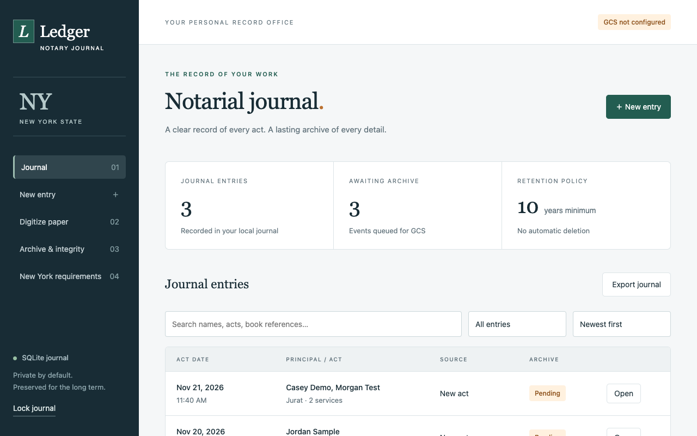
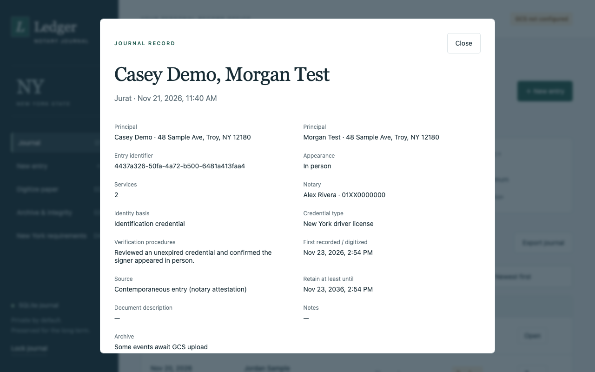
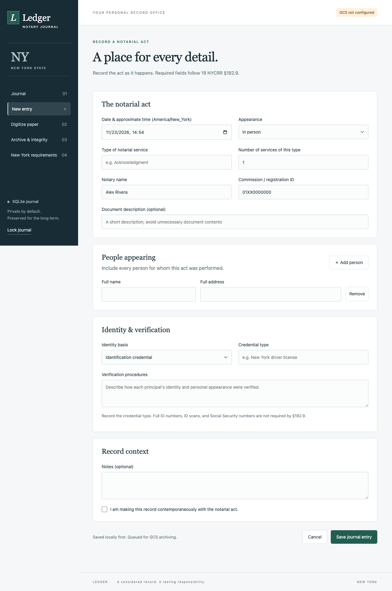
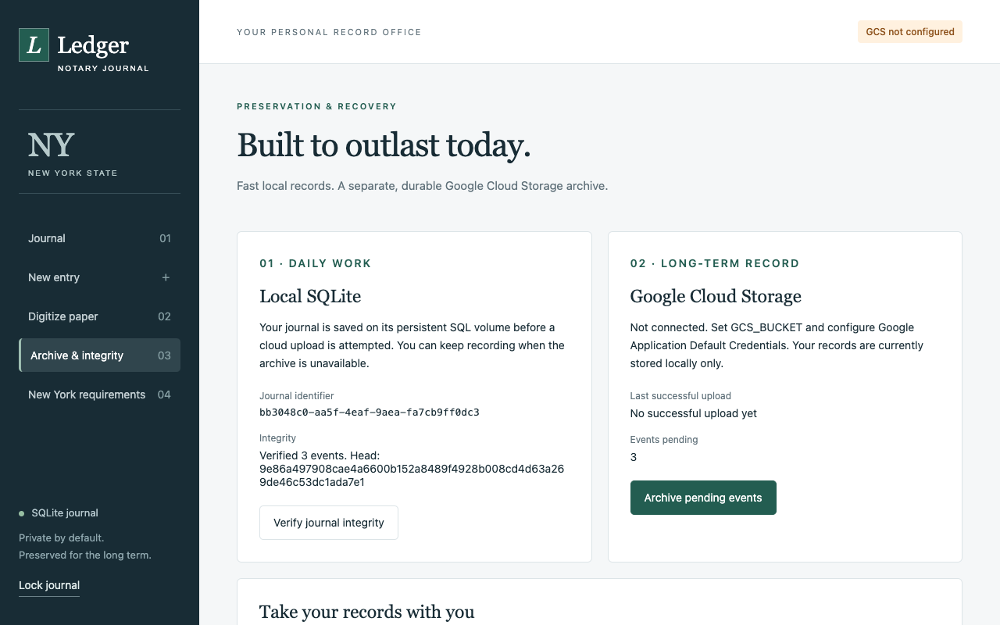
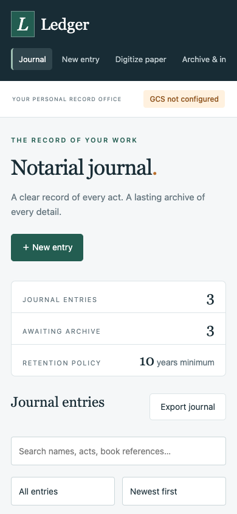
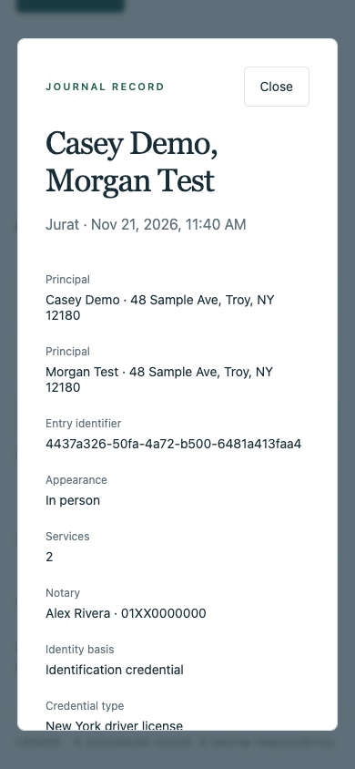
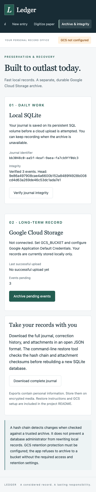

# Ledger — New York Notary Journal

A Go application for a single New York notary: SQLite for fast access, Google Cloud Storage for long-term archival, and an embedded browser interface. Deploy on a workstation or Kubernetes using the included Helm chart. No Python runtime, Node build, external SQL server, or CGO is required.

## Screenshots

Fictional demo data, regenerated with `make screenshots`.

| | |
|---|---|
|  |  |
|  |  |

On a phone:

<p>



</p>

## Run locally

Requires Go 1.27 or later.

```sh
make build
```

`make run` builds and starts the server (requires the password variable below).

Set `NOTARY_PASSWORD` to a password of at least 16 characters through your password manager/private environment, or point `NOTARY_PASSWORD_FILE` at a protected password file. Then:

```sh
./bin/notary-journal serve
```

Open **http://127.0.0.1:8087**. Defaults are loopback access and `data/journal.sqlite3`. The interface is embedded in the binary. There is no generated or default password. A password file takes precedence over the environment value and trailing line endings are removed. Restart after password rotation; sessions expire after eight hours or a restart.

Options appear **before** the command:

```sh
./bin/notary-journal --db /path/to/journal.sqlite3 --listen 127.0.0.1:8087 serve
```

| Configuration | Default / meaning |
|---|---|
| `NOTARY_DB` / `--db` | `data/journal.sqlite3` |
| `LISTEN_ADDR` / `--listen` | `127.0.0.1:8087` |
| `PUBLIC_URL` / `--public-url` | Browser origin; derived for local access, required for a network listener |
| `NOTARY_PASSWORD` | Password from a private environment |
| `NOTARY_PASSWORD_FILE` | Protected file containing the password; preferred in Kubernetes |
| `NOTARY_NAME` / `--notary-name` | Optional. Notary name pre-filled (still editable) on new entries; stored with each entry as submitted |
| `NOTARY_COMMISSION_ID` / `--commission-id` | Optional. Commission/registration ID pre-filled on new entries |
| `GCS_BUCKET` | Bucket name; unset means SQLite-only operation |
| `GOOGLE_APPLICATION_CREDENTIALS` | Optional ADC file; otherwise Google's standard ADC discovery applies |

Remote public URLs must use HTTPS. The server itself serves HTTP behind your TLS ingress/reverse proxy. It validates the actual Host and mutation Origin against `PUBLIC_URL` and ignores forwarded-host headers. Configure the proxy to preserve the external Host. Health probes are available at `/healthz` and `/readyz` without exposing journal data.

## Journal workflow

- **Journal list:** newest first by default, with a toggle for oldest first. Search matches names, addresses, act types, book references and displayed dates.
- **New entry:** contemporaneous act details, all principals and their addresses, service type/count, identity basis, applicable witnesses and verification procedures. Use separate entries for different service types.
- **Digitize paper:** manually transcribe a record and its book/page reference. If the approximate time is absent, use the date-only option. Save, open the record, then attach the original scan. A separate timestamp records digitization. Keep paper originals and explicitly describe missing historical facts; never invent them. OCR is outside this release.
- **History and corrections:** preserve the original, add a complete correction with a reason, inspect history, download attachments, and print the selected record.
- **Archive & integrity:** see pending events, retry uploads, verify the event chain, and export the complete journal. An entry is “Archived” only when all its events have verified upload receipts.

Act timestamps carry an offset; the form displays the browser's local time zone. Source files support PDF, JPEG, PNG, MP4, M4A and MP3, up to 64 MiB per file. Uploads are permanent events and are served as downloads. Review files first; the app does not scan for malware. Electronic-act metadata includes a stable recording reference and separate-retention attestation; the app is not a remote-notarization platform.

## Build and deploy with Helm

Requires Kubernetes ≥1.27, Helm 3+, a container registry, and a suitable persistent-volume StorageClass. The chart uses **one StatefulSet replica**, a durable PVC, retained claims, a non-root distroless image, read-only root filesystem, health probes, resource limits, a Secret-mounted password, and optional ingress/network policy.

Build and push an image to a registry your cluster can read. Replace the registry/repository below with yours:

```sh
docker build -t YOUR_REGISTRY/notary-journal:0.1.0 .
docker push YOUR_REGISTRY/notary-journal:0.1.0
```

Create a namespace and password Secret from an existing protected password file. Avoid passwords in shell arguments, Helm values, or source control:

```sh
kubectl create namespace notary
kubectl -n notary create secret generic journal-auth \
  --from-file=password=/secure/path/journal-password
```

Install privately, without ingress:

```sh
helm upgrade --install journal ./deploy/helm/notary-journal \
  --namespace notary \
  --set image.repository=YOUR_REGISTRY/notary-journal \
  --set image.tag=0.1.0 \
  --set auth.existingSecret=journal-auth \
  --wait --timeout 10m

kubectl -n notary port-forward service/journal-notary-journal 8087:8087
```

Open **http://127.0.0.1:8087**. Keep the forwarded port consistent with `publicURL` (defaults to that exact origin). This installation stores locally on its PVC until GCS is configured. Helm will not provision a bucket or invent credentials.

### HTTPS ingress and GCS

Use a private values file, for example:

```yaml
image:
  repository: YOUR_REGISTRY/notary-journal
  tag: "0.1.0"
auth:
  existingSecret: journal-auth
notary:            # optional: pre-fill new entries (single-notary deployment)
  name: Your Name
  commissionId: "01XX0000000"
publicURL: https://journal.example.com
ingress:
  enabled: true
  className: nginx
  host: journal.example.com
  annotations:
    nginx.ingress.kubernetes.io/proxy-body-size: "90m"
    nginx.ingress.kubernetes.io/proxy-read-timeout: "600"
  tls:
    - secretName: journal-tls
      hosts: [journal.example.com]
persistence:
  size: 10Gi
  # storageClass: your-block-storage-class
gcs:
  bucket: YOUR_PRIVATE_BUCKET
serviceAccount:
  annotations:
    iam.gke.io/gcp-service-account: notary-archive@YOUR_PROJECT.iam.gserviceaccount.com
```

```sh
helm upgrade --install journal ./deploy/helm/notary-journal \
  --namespace notary --values /secure/path/notary-values.yaml \
  --wait --timeout 10m
```

Set up DNS, the ingress controller and TLS Secret first. The example uses **GKE Workload Identity**, which also requires cluster/node-pool support and the appropriate IAM binding between this release's Kubernetes service account (`journal-notary-journal` in namespace `notary`, unless overridden) and the Google identity. The annotation alone does not grant access. Keep `publicURL` exactly equal to `https://<ingress.host>`.

For a pre-existing ADC credential file instead, create a Kubernetes Secret externally and configure the chart to mount it:

```sh
kubectl -n notary create secret generic journal-gcs \
  --from-file=credentials.json=/secure/path/adc.json
```

```yaml
gcs:
  bucket: YOUR_PRIVATE_BUCKET
  credentialsSecret: journal-gcs
  credentialsKey: credentials.json
```

Prefer federation/short-lived identity over service-account keys. An external-account ADC configuration is supported by Google's OAuth2 library, but its referenced subject-token files/audiences must also exist in your runtime. The generic credential mount is not a turnkey federation setup for every provider. No credentials are included in the image or chart.

Set `imagePullSecrets` for a private image registry. For an existing volume use `persistence.existingClaim`; otherwise the StatefulSet creates a retained claim. Use block/local storage with correct POSIX locks and encrypted disks. **Do not use NFS, GCS FUSE or another shared/object filesystem for SQLite.** ReadWriteOncePod is an optional access mode where the CSI driver supports it.

Do not scale above one replica or operate two writable restored copies of one journal. The chart rejects `replicaCount`; there is no autoscaler. Normal StatefulSet updates replace the single ordinal in order. Never force-delete a live writer to bypass a stuck rollout: confirm it has stopped before attaching its volume elsewhere. Expect brief update downtime.

The optional NetworkPolicy denies inbound traffic unless `networkPolicy.ingress` allows your ingress-controller pods. It allows DNS and HTTPS egress, with `extraEgress` for provider metadata endpoints. Check your CNI and identity provider's exact networking requirements before enabling it.

PVCs created by this chart are retained on uninstall. Do not delete them just because a release was removed. Archive credentials need access for the complete retention period. Password/credential changes require a controlled restart; sessions are process-local.

## Configure the long-term GCS archive

Use a private bucket with:

- Uniform bucket-level access and **enforced** public access prevention.
- At least **3660 days** (316224000 seconds) of bucket retention, measured from upload.
- Prefer object versioning and no automatic deletion policy.
- A dedicated runtime identity with `storage.buckets.get`, `storage.objects.create`, `storage.objects.get`, and `storage.objects.list` on this bucket; no deletion or policy-administration permissions.

The app checks the bucket policy before each sync, creates events with `ifGenerationMatch=0`, and reads back a specific object generation before recording success. Failed uploads remain pending. Retries check existing objects without overwriting them. GCS JSON API requests use Google's maintained OAuth2 library for ADC; no custom credential-signing logic is implemented.

[infra/main.tf](infra/main.tf) provisions the bucket and a least-privilege custom-role binding. The GCP project, Storage API and chosen service account must already exist:

```sh
cd infra
terraform init
terraform plan \
  -var='project_id=YOUR_PROJECT' \
  -var='bucket_name=YOUR_GLOBALLY_UNIQUE_BUCKET' \
  -var='archive_writer_member=serviceAccount:notary-archive@YOUR_PROJECT.iam.gserviceaccount.com' \
  -out=journal.tfplan
terraform apply journal.tfplan
```

The supplied retention policy is **unlocked** for setup review. A privileged administrator could shorten it; runtime credentials cannot. After testing upload and recovery, separately review the irreversible decision to lock it. The app never locks retention automatically. GCS encrypts stored data by default; maintaining billing, IAM and any customer-managed encryption keys remains your responsibility.

For workstation ADC:

```sh
gcloud auth application-default login
export GCS_BUCKET='YOUR_BUCKET'
./bin/notary-journal serve
```

Automatic sync runs once per minute while serving. Manual sync is available in the interface or through `notary-journal sync`. Pending records remain on SQLite and are not recoverable from GCS until uploaded. Readback receipts confirm an upload, not that administrators have never changed the bucket afterward.

## Export and recover

The event schema, hash encoding, object names and SQLite tables remain compatible with the original Python implementation. **Stop the old process before opening its database with Go.** Preserve a backup first. Point `--db` at the existing database, or restore a v1 export into a new database. No history is rewritten.

```sh
./bin/notary-journal verify
./bin/notary-journal export /encrypted-media/journal-export.json
./bin/notary-journal --db /path/to/recovered.sqlite3 restore /encrypted-media/journal-export.json
./bin/notary-journal --db /path/to/recovered.sqlite3 verify
```

JSON exports include original entries, corrections, and attachment bytes. They are plaintext; protect the destination. Export refuses to overwrite existing files. Restore requires an empty database, verifies the complete chain and attachment checksums, preserves the journal UUID, and rebuilds the queue as pending. Re-sync safely confirms objects already in GCS.

Record your journal UUID from **Archive & integrity** outside the journal computer/cluster. To restore from the cloud:

```sh
GCS_BUCKET=YOUR_BUCKET ./bin/notary-journal --db /path/to/recovered.sqlite3 \
  restore-gcs YOUR_JOURNAL_UUID
```

Recovery downloads all event objects under `journals/<journal UUID>/events/`, including paginated results, and checks sequence, identity, hashes and file checksums. Missing interior events and forks fail validation. A trusted exported head hash/event count is needed to detect missing tail events. Cloud recovery intentionally remains available even if a bucket's retention settings have changed.

For a running Helm release, run maintenance commands inside the existing pod (no shell is required in the image):

```sh
kubectl -n notary exec journal-notary-journal-0 -- /notary-journal verify
kubectl -n notary exec journal-notary-journal-0 -- /notary-journal sync
```

Use the authenticated interface to download the full export. Restore into a new, empty journal volume while the writer is stopped, validate it, then start exactly one writer. Whole-journal verification/exports/restores currently load event payloads in memory; allocate RAM for large journals. Copying only an open SQLite file can lose WAL transactions: use an app export or SQLite's online backup API. Retain encrypted PVC snapshots/backups for pending events too.

## Law and security

The [legal review](docs/LEGAL_REVIEW.md) maps New York's September 2026 published License Law and **19 NYCRR §§182.8–182.9** to the implementation. It covers required fields, contemporaneous recording, ten-year retention, producibility and the additional obligations for electronic acts. It does not certify compliance or authorize destruction of paper originals.

The app preserves originals and has no deletion feature. SHA-256 chaining detects changes against a trusted head/archive; it does not prevent a privileged administrator from rewriting the local file. The password protects browser access, **not SQLite encryption**. Use encrypted disks/PVCs, tightly controlled cluster/node access, encrypted backups and secret encryption at rest. Hosted TLS is terminated by your ingress. Journal text is rendered without HTML interpolation and attachments are downloads. Request bodies and principal data are not logged.

See [docs/ARCHITECTURE.md](docs/ARCHITECTURE.md) for event format, trust boundaries and capacity limits.

## Checks and verification limits

```sh
make test        # go test -race, including in-memory HTTP and Helm checks if Helm is installed
make check       # go vet and JavaScript syntax
make helm-check
make e2e         # Playwright browser tests (needs Node; downloads Chromium)
```

Tests include a Python-produced compatibility fixture, concurrent SQLite writers, immutable history, corrections, source attachment recovery, tamper refusal, failed archive uploads, idempotent retries, paginated recovery, real GCS request semantics through an HTTP transport stub, password sessions, CSRF/Host protections and chart configuration safeguards.

A Linux binary is cross-compiled with CGO disabled. No live GCS credentials or bucket were supplied, and no cluster was deployed. The Docker image was built and run read-only/non-root with a volume, and its data persisted across a restart. Playwright tests in `e2e/` drive the real UI in headless Chromium (login, entry, XSS-as-text, attachment, correction, integrity check, paper import, phone-width layout). Cluster rollout, ADC/IAM and a real GCS upload/restore should be verified in the target environment before relying on it for journal preservation.

## Contributing and license

Released under the [MIT License](LICENSE). See [CONTRIBUTING.md](CONTRIBUTING.md) and [SECURITY.md](SECURITY.md). This software is provided without warranty and is not legal advice; you remain responsible for your own compliance with New York notary law.
