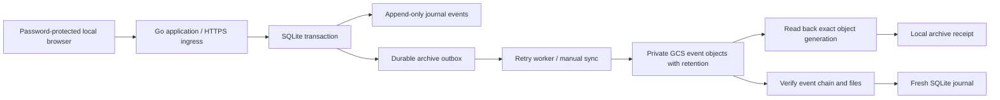

# Architecture and operational model

## Data flow

One commissioned notary uses one active journal database. A Go HTTP server supplies an embedded static UI and an authenticated JSON API. It runs on a workstation or as a single-replica Kubernetes StatefulSet, with SQLite on a persistent volume. Local SQLite is the immediate durable store, with WAL and `synchronous=FULL`. GCS is the independent long-term recovery source after successful synchronization. Browser localStorage is not used for journal data, sessions, passwords, or drafts.

## Event model

Every event includes a monotonic sequence, random event UUID, journal UUID, entry UUID, event kind, recorded-at UTC timestamp, previous SHA-256 hash, JSON payload, and its own hash. Canonical JSON uses sorted keys, compact separators, UTF-8 and unescaped Unicode. Hash input includes every field except the hash itself. The initial predecessor is 64 zeroes.

- `entry` stores the original complete act record, original act timestamp, source classification, and retain-until policy date.
- `correction` stores a complete replacement view and a reason, linked by entry UUID. The original event is preserved. The record list projects the latest complete view.
- `attachment` stores basename, declared MIME, length, content checksum, and base64 bytes. It is an independent event linked to the same entry, so a file and its metadata cannot become detached in an export.

A single-connection SQL pool serializes local writers. SQL transactions insert an event and its matching outbox item atomically. SQLite enforces its filesystem lock across maintenance processes too; independent writable database copies are unsupported. SQL triggers reject updates and deletions on the event table. An OS/database administrator can remove triggers or rewrite the database; app controls do not prevent that. No cryptographic signing or independent trusted timestamp service is claimed.

The outbox stores archived-at timestamps, GCS object generations, and sanitized error messages. It is mutable operational metadata, excluded from the evidentiary chain. An export reconstructs all events in sequence and includes attachment content; a restore validates before beginning insertion and requires an empty event table.

## Cloud objects and recovery

Object names are `journals/<journal UUID>/events/<12-digit sequence>-<event hash>.json`. No principal name or address appears in an object name. JSON bodies contain sensitive journal information. Uploads use a create-only generation precondition. A crash between cloud success and local receipt is safe: the next attempt checks the existing bytes before marking success. A mismatch never clears the outbox.

Bucket policy is checked at the start of each sync. Use a dedicated archive identity with read/create/list and bucket-metadata access, without deletion, overwrite, or policy-change privileges. The application relies on GCS default encryption at rest and HTTPS JSON API requests authenticated with Google’s maintained OAuth2 ADC library. Bucket configuration, IAM ownership, retention locking, billing and identity recovery remain operational responsibilities.

Cloud restore lists all objects under the journal prefix, verifies sequential order, uniqueness, journal identity, predecessor/content hashes, relationships, and attachment checksums, then reconstructs the SQL database. A fork or missing interior event fails validation. A trusted count/head from an independently retained export is needed to detect a missing tail. Loss of unsynced local events cannot be repaired from GCS.

## Access model

The server defaults to `127.0.0.1`. A network listener requires an explicit `PUBLIC_URL`; a non-loopback public origin must use HTTPS. Kubernetes listens on the pod network behind a TLS ingress, or uses a loopback public URL with private port-forwarding. A password of at least 16 characters unlocks an HttpOnly, SameSite=Strict, random session cookie for eight hours. Cookies are Secure for an HTTPS public URL. Passwords come from a private environment or mounted Secret file; the application stores no on-disk password verifier. The password is kept as a comparison digest in process memory; no password verifier or plaintext password is persisted. Login attempts are limited to ten per minute in that process. A restart invalidates sessions. Loopback HTTP does not use TLS or a Secure cookie. Hosted HTTPS terminates at the ingress; the app does not trust forwarded Host headers and validates browser Host and mutation Origin against the configured public URL. The cluster and ingress-to-pod network are part of the trusted boundary.

Mutations require the exact configured Origin and JSON content type; journal/static requests require an allowlisted Host to resist DNS rebinding. GET health probes bypass Host/auth checks and reveal only liveness/database connectivity. API reads require authentication except the session-status endpoint. Static files are public to the local computer but contain no journal data. Responses disable caching, set nosniff and deny framing, and use a restrictive CSP. Untrusted field values are inserted with `textContent` and never interpolated as HTML. Attachments use download disposition. Request logging is omitted so principal data is not printed to logs.

This does not protect a compromised browser, OS account, privileged local process, or unencrypted copied database. Use trusted hosts/cluster nodes and encrypted storage. Multi-user tenancy, shared database files over NFS/object FUSE, password recovery, user administration, and formal penetration testing are outside this release. The chart enforces one replica, uses a non-root read-only container and retained PVC, and provides probes and optional network policy. Secret data and PVC encryption depend on cluster configuration.

## Capacity and release limits

This is designed for a personal journal. The list reads event metadata into memory and filters in the browser; exports and restores read all events, including base64 file content, into memory. Large attachments and very large journals can require substantial RAM. Each file is capped at 64 MiB, JSON requests at 90 MiB. Multiple simultaneous file operations can use much more memory; do not use it as a bulk video repository. Retain large recordings with a suitable separately protected provider/archive and save their stable reference. There is no OCR, scan redaction, virus scanning, upload deduplication, or automated legal completeness judgment for historical records.

Automatic sync runs only while the server is running. For continuous operation run under an OS service manager or the supplied Helm StatefulSet with a protected environment and durable disk access. Shutdown responds to SIGTERM, cancels archive work and drains HTTP requests; startup verifies the existing event chain before serving. Avoid overlapping independently restored writers. Preserve the application version and schema when making disaster-recovery plans; schema upgrades will need explicit migrations in later releases.

## Go port compatibility and verification

The SQLite tables, v1 event schema, canonical JSON hash encoding, and cloud object names remain compatible with the Python implementation. A committed synthetic Python-generated fixture checks literal Unicode, escaping, original entries, corrections and attachments. The Python runtime has been replaced by the Go binary, using pure-Go SQLite and Google OAuth2 ADC support. Go's canonical writer deliberately matches v1 rather than switching hashes to Go's default struct/HTML-escaped JSON representation.

Automated tests cover storage integrity, concurrent appends, immutable history, legacy recovery, source-file recovery, record validation, cloud policy refusal, create-only request preconditions, generation-pinned downloads, pagination, retry after local receipt loss, session/CSRF/Host checks and HTTP workflows without opening sockets. Helm checks cover default and HTTPS/existing-PVC/credential configurations and reject unsupported multi-writer or insecure ingress settings. JavaScript syntax, Go vet, race detection and a static Linux build are also checked.

Playwright end-to-end tests in `e2e/` exercise the embedded UI against a real server in headless Chromium. The Docker image was built and run with a read-only root filesystem, dropped capabilities and a named volume; data persisted across a restart and SIGTERM exited cleanly. No live GCS bucket or target-cluster rollout was available for validation. Before production use, test the actual persistent volume, TLS path, identity grants, upload and recovery in the intended environment. A hash chain or successful render is not a certification of legal compliance or infrastructure durability.
